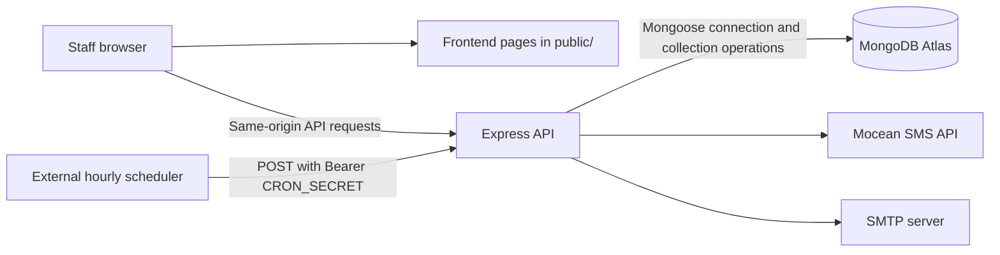
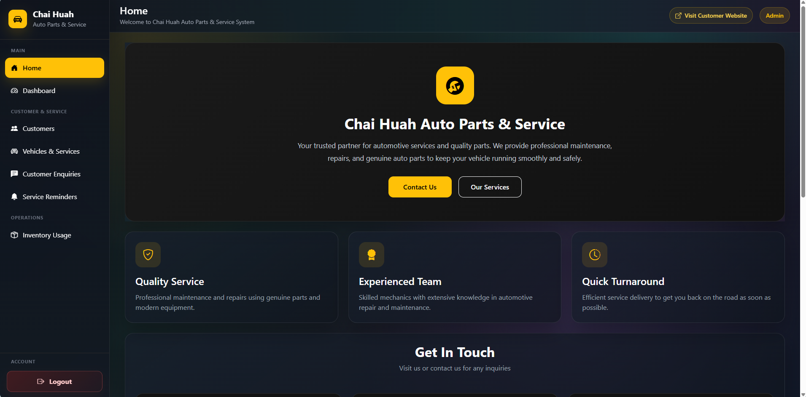
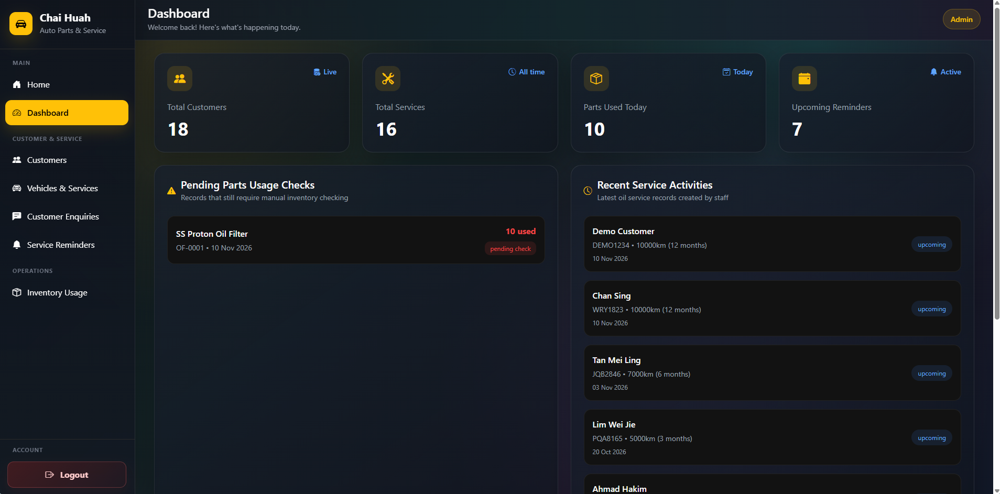
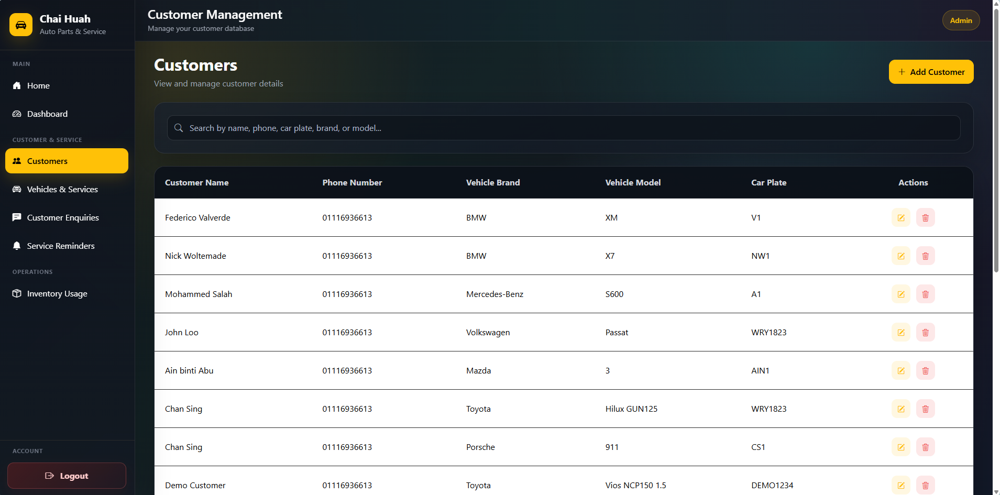
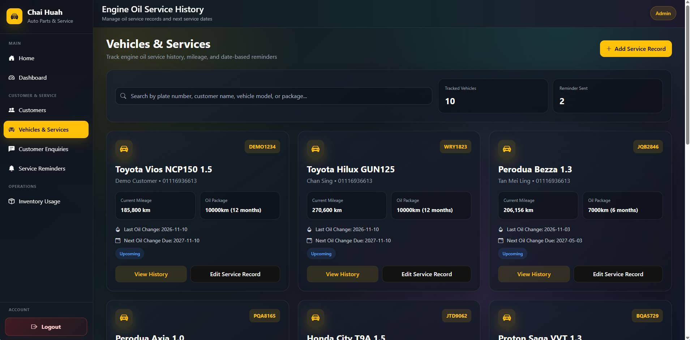
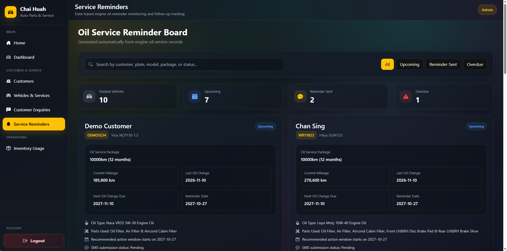
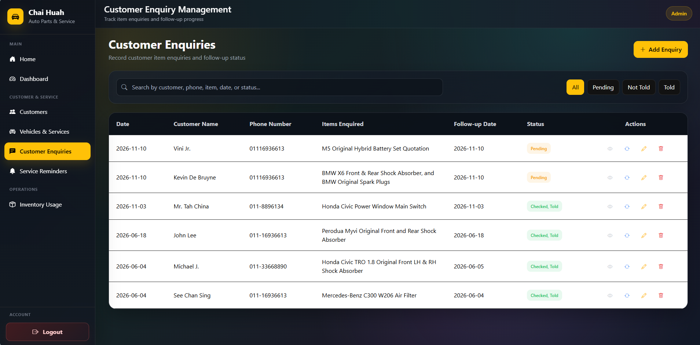
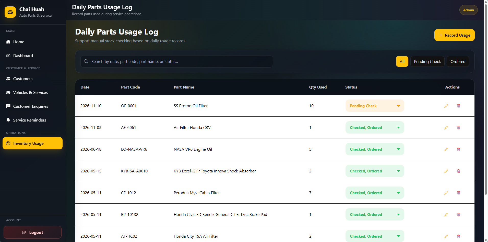

# Auto Service & Parts Management System

A web-based management system for the daily customer, vehicle service, enquiry, and parts-usage workflows of an automotive service and parts business. The project is See Chan Sing's Final Year Project (FYP) at Universiti Malaya.

**Production deployment:** [chai-huah-auto-service.vercel.app](https://chai-huah-auto-service.vercel.app)<br>
**GitHub repository:** [CSing1823/fyp-auto-service-parts-management-system](https://github.com/CSing1823/fyp-auto-service-parts-management-system)

## 1. Project Overview

The system provides staff with a browser-based workspace for customer records, vehicles and service history, service reminders, customer enquiries, and inventory usage. It combines a static HTML/CSS/JavaScript frontend with an Express API and MongoDB Atlas.

The frontend and API use the same origin in the deployed application. In local development, VS Code Live Server serves the frontend while Express runs separately.

## 2. Project Objectives

- Keep customer and vehicle information available alongside service history.
- Track oil-service dates and identify upcoming or overdue reminder windows.
- Support staff workflows for enquiries and daily parts usage.
- Present operational summaries through a dashboard.
- Protect staff pages and API operations with server-validated authentication.

## 3. Key Features & Modules

| Module | Current functionality |
|---|---|
| Dashboard | Summarizes customer and service counts, parts used today, upcoming reminders, recent service activity, enquiry follow-ups, and charts. |
| Customer Management | Create, view, search, edit, and delete customer records. |
| Vehicle Management | Track vehicles and their service records, including customer and vehicle details, mileage, service package, and service dates. |
| Service Tracking | Calculates next service due dates and reminder dates from the service date and selected oil-service package. |
| SMS Reminders | Processes eligible reminders, records delivery outcomes and attempt history, and provides staff with failed-reminder retry controls. |
| Customer Enquiry Management | Record, search, update, and delete enquiries, including follow-up dates and enquiry status. |
| Inventory Usage Monitoring | Record and maintain parts-usage entries with date, part details, quantity, and status. |
| Staff Access | Staff login, session validation, logout, and email OTP password reset. |

## 4. Technology Stack

| Layer | Technology |
|---|---|
| Frontend | HTML, CSS, Bootstrap 5.3.3, and JavaScript |
| Backend | Node.js 22 and Express 5 |
| Database access | Mongoose 9 connected to MongoDB Atlas |
| SMS provider | Mocean |
| Password reset email | SMTP over TLS |
| Hosting | Vercel |
| Local frontend development | VS Code Live Server on port `5501` |
| Local backend development | Express on port `3000`, started with `npm start` |

## 5. System Architecture



In the deployed project, Vercel hosts the frontend assets and Express API. The current workspace has no `vercel.json`; deployment configuration and environment variables are managed through the Vercel project. Locally, Live Server serves `public/` at the site root and the frontend sends API requests to `http://127.0.0.1:3000`.

## 6. Database Design

Mongoose manages the MongoDB connection, while the current backend performs operations directly on MongoDB collections. The source does not define Mongoose schemas or models.

| Collection | Purpose |
|---|---|
| `Customers` | Customer contact and vehicle information. |
| `Vehicles&Services` | Vehicle service records, service dates, calculated reminder dates, SMS status, and attempt history. |
| `customerEnquiries` | Customer enquiry details, status, and follow-up date. |
| `InventoryUsage` | Parts-usage records and their status. |
| `staffUsers` | Staff accounts and password hashes. |
| `staffSessions` | Hashed session identifiers and server-side expiry timestamps. A TTL index supports expired-session cleanup. |
| `passwordResetOtps` | Password-reset OTP and verification state. |

The backend also contains an explicit maintenance migration command for legacy collection/data transitions. Normal `npm start` does not run those migrations.

## 7. Authentication & Security

- Staff passwords are hashed with Node.js `scrypt` before storage.
- Successful login creates a random server-side session record in MongoDB. The browser receives an HttpOnly cookie; the session identifier itself is stored as a hash in the database.
- The cookie is a browser-session cookie. The server validates session expiry independently and expires sessions after eight hours.
- Logout revokes the MongoDB session and clears the cookie.
- Protected frontend pages validate the session with the backend before revealing page content. Protected API routes also validate the session server-side.
- Production cookies use `Secure` over HTTPS and `SameSite=Lax`. API write/authentication requests are checked against approved origins.
- Password reset uses an emailed OTP and server-side verification state. Configure SMTP credentials only in server-side environment settings.

## 8. SMS Reminder System

Local development starts reminder processing after MongoDB is ready, then checks hourly by default. The interval can be changed locally with `SMS_REMINDER_CHECK_INTERVAL_MS`. When Mocean is not configured for non-production local use, the application uses its mock SMS behavior.

Vercel Production and Preview do not run a persistent `setInterval()` scheduler. An external scheduler should call `POST /api/cron/sms-reminders` hourly and send `Authorization: Bearer <CRON_SECRET>`. The endpoint is protected for server-to-server use and calls the same `processDueSmsReminders()` function used by local scheduling and the staff processing action. The cron request processes up to 25 reminders and reports whether more remain.

Reminder records use `Pending`, `Processing`, `Sent`, `Failed`, `Unknown`, and `Superseded` outcomes. Atomic claims and attempt history help prevent concurrent processing. `Sent` means Mocean accepted the request; it does not confirm handset delivery. Ambiguous outcomes become `Unknown` and are not automatically retried. Staff can retry eligible `Failed` reminders. A newer service record supersedes an older reminder.

## 9. Screenshots

| Screen | Screenshot |
|---|---|
| Login Page |  |
| Home |  |
| Dashboard |  |
| Customer Management |  |
| Vehicles & Services |  |
| Service Reminders |  |
| Customer Enquiries |  |
| Inventory Usage |  |

## 10. Installation & Local Development Setup

### Requirements

- Node.js 22 and npm.
- A MongoDB connection string and a database user with access to the application database.
- VS Code with Live Server for the frontend.
- Mocean credentials for real SMS delivery. Without Mocean credentials, non-production local runs use mock SMS behavior.
- SMTP settings if password-reset email is to be used.

### Setup

1. Clone the repository and install dependencies:

   ```bash
   git clone https://github.com/CSing1823/fyp-auto-service-parts-management-system.git
   cd fyp-auto-service-parts-management-system
   npm install
   ```

2. Create a `.env` file in the project root. Use the following as a template and replace placeholders locally. Do not commit `.env` or share its values.

   ```dotenv
   # Database
   MONGODB_URI=mongodb+srv://<database-user>:<url-encoded-password>@<cluster-host>/<database>?retryWrites=true&w=majority

   # Local frontend origins
   FRONTEND_ORIGINS=<approved-origin-1>,<approved-origin-2>

   # Local runtime and session cookie settings
   NODE_ENV=<development-or-production>
   COOKIE_SECURE=<true-or-false>

   # Email OTP for password reset
   SMTP_HOST=<smtp-host>
   SMTP_PORT=<smtp-port>
   SMTP_USER=<smtp-user>
   SMTP_PASS=<smtp-password>
   SMTP_FROM=<sender-address>
   PASSWORD_RESET_EMAIL=<password-reset-recipient>

   # SMS; optional for mock SMS in non-production local development
   MOCEAN_API_TOKEN=<mocean-api-token>
   MOCEAN_FROM=<approved-sender-id>
   SMS_REMINDER_CHECK_INTERVAL_MS=<interval-in-milliseconds>

   # Needed by the external production scheduler, not frontend code
   CRON_SECRET=<long-random-secret>
   ```

   `VERCEL` and `VERCEL_ENV` are provided by Vercel and are not local `.env` settings. The built-in origin allowlist already includes `http://127.0.0.1:5501` and `http://localhost:5501`; set `FRONTEND_ORIGINS` only for additional explicitly approved origins. Replace all template placeholders before using this file.

3. Start the backend in a terminal:

   ```bash
   npm start
   ```

4. In VS Code, open `public/index.html` with **Open with Live Server**. The workspace configuration serves the `public/` directory on port `5501`; the backend runs separately on port `3000`.

5. Create or update a staff account when needed. The command accepts the email and password as arguments; use a strong local password and avoid sharing shell history or terminal output:

   ```bash
   npm run seed-staff -- staff@example.com "REPLACE_WITH_A_STRONG_PASSWORD" "Staff Name" "Admin"
   ```

The explicit migration command is separate from normal startup and requires confirmation. Review the migration code and take a verified backup before using it against any database:

```bash
npm run migrate -- --confirm
```

## 11. Production Deployment

The production site is hosted at [chai-huah-auto-service.vercel.app](https://chai-huah-auto-service.vercel.app). Configure production values in Vercel Project Settings > Environment Variables; do not put credentials in frontend code or Git.

| Variable | Purpose |
|---|---|
| `MONGODB_URI` | Connects the backend to the production MongoDB Atlas database. |
| `MOCEAN_API_TOKEN` | Authenticates real Mocean SMS requests. |
| `MOCEAN_FROM` | Configures the Mocean sender ID. |
| `CRON_SECRET` | Authenticates the external hourly scheduler. Keep it server-side. |
| `COOKIE_SECURE` | Set to `true` for HTTPS-only session cookies. |
| `NODE_ENV` | Set to `production` for production behavior. |
| `FRONTEND_ORIGINS` | Optional comma-separated additional origins to add to the built-in allowlist. The canonical Production origin and the two local Live Server origins are already included; wildcards are not supported. |
| `SMTP_HOST`, `SMTP_PORT`, `SMTP_USER`, `SMTP_PASS`, `SMTP_FROM` | Configure the SMTP service used for password-reset email. |
| `PASSWORD_RESET_EMAIL` | Sets the recipient used by the password-reset flow. |

After configuring the environment, deploy through Vercel and verify login, protected API access, logout, CRUD workflows, and password-reset email as applicable. Configure an external scheduler such as cron-job.org to call `POST /api/cron/sms-reminders` hourly with the bearer secret. The project does not configure a Vercel Cron schedule.

## 12. Future Enhancements

### Stronger Backup & Recovery Strategy

This is a future enhancement and is not described as an implemented feature. Planned work includes:

- Explore MongoDB Atlas automated backup options.
- Assess whether regular database exports are appropriate.
- Evaluate secure, access-controlled backup storage.
- Test database restoration and verify data integrity after restore.

## 13. Author

**See Chan Sing**<br>
Bachelor of Computer Science (Information Systems)<br>
Universiti Malaya (UM)

This project was developed as part of my Final Year Project (FYP).
